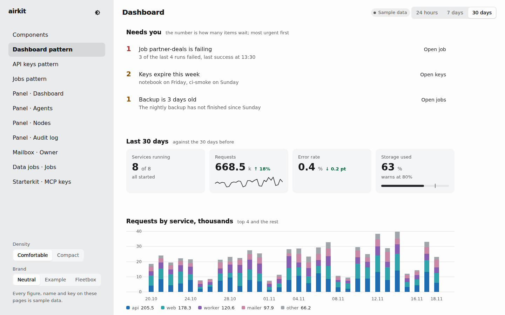

# airkit

airkit is a theme and a set of widgets for admin panels built on
[$mol](https://mol.hyoo.ru). The theme, «Air», separates things by spacing and
three ground tones instead of lines, uses one accent and three state colours
(ok, warn, bad), and system fonts only. The widgets are the ones stock $mol
lacks for a panel: status pills, stat tiles, a "Needs you" list, a confirm
page, a secret shown once, a stacked chart, and a few more.



Demo: <https://alexesdev.github.io/airkit/> — every widget in every state, the
patterns, and real product screens rebuilt with the kit. All data in it is
sample data.

## Connect it to your project

### 1. Add the package to your mam workspace

A mam workspace is the directory you build in (a clone of
[hyoo-ru/mam](https://github.com/hyoo-ru/mam)). Its root `.meta.tree` lists
packages mam fetches by itself. Add one line:

```tree
pack airkit git \https://github.com/alexesDev/airkit.git
```

The first build that meets an `$airkit_…` name clones the repository into
`<workspace>/airkit` and builds it with your app. Nothing else to install.

### 2. Plug the theme into your app root

```tree
$my_app $mol_book2_catalog
	plugins /
		<= Theme $mol_theme_auto
		<= Air $airkit_air
			density \comfortable
```

`$airkit_air` is a `$mol_plugin`: it sets the `airkit_air` attribute on the
root, defines the tokens, and maps them onto `--mol_theme_*`, so stock $mol
components follow the theme. `density` is `comfortable` or `compact`.

### 3. Dark mode

`$mol_theme_auto` follows the system and `$mol_lights_toggle` switches it by
hand. The theme defines a light and a dark set of every token under
`[airkit_air][mol_theme="$mol_theme_dark"]`; you do nothing more.

### 4. Your own palette

A palette reassigns tokens and changes no rule. Put a CSS file in your app's
module and scope it to the theme:

```css
[airkit_air][mol_theme="$mol_theme_light"] {
	--airkit_accent: oklch(46% .15 262);
	--airkit_accent_strong: oklch(38% .15 262);
	--airkit_selected: oklch(46% .15 262 / .11);
	--airkit_focus: oklch(52% .17 262);
}

[airkit_air][mol_theme="$mol_theme_dark"] {
	--airkit_accent: #8bb7ff;
	--airkit_accent_strong: #c5dbff;
	--airkit_selected: #111f34;
	--airkit_focus: #8bb7ff;
}
```

To switch palettes at run time, the way the demo does, scope them by name and
add `$airkit_brand` with that name to the root's plugins:
`[airkit_air][airkit_brand="acme"][mol_theme="$mol_theme_dark"] { … }`.
`brand/example.view.css` and `brand/fleetbox.view.css` are two such palettes.

### 5. Docker and CI

mam clones the package on the first build, over public HTTPS: no keys, no
submodule. In a Dockerfile, add the `pack` line to the workspace's
`.meta.tree` before the build step; the image then builds from a clean
workspace.

## Widgets

The demo link in each row opens the gallery, where every state is shown. Each gallery section and each demo screen carries a source link (the script icon) to its folder in this repository.

| Widget | For | Main properties | States |
|---|---|---|---|
| `$airkit_pill` | a status | `title`, `tone` | `ok`, `warn`, `bad`, `neutral` |
| `$airkit_stat` | one figure in a tile | `label`, `value`, `unit`, `note`, `delta`, `delta_unit`, `higher_is_better`, `series`, `portion`, `tick` | with delta (its tone follows `higher_is_better`), with sparkline, with limit meter, `measured false` says «Not measured» |
| `$airkit_tiles` | a grid of stat tiles | `sub` | — |
| `$airkit_meter` | a fill from 0 to 1 with a tick at the limit | `portion`, `tick`, `tone` | `neutral`, `warn`, `bad` |
| `$airkit_spark` | a sparkline, a `$mol_plot_pane` with one line | `series` | — |
| `$airkit_kv` | a key–value card | `fields` (dictionary) | — |
| `$airkit_attention` | «Needs you»: count, what, why, where to act | `entries` (`count`, `tone`, `what`, `why`, `action`, `arg`) | empty: «Nothing needs you» |
| `$airkit_feed` | activity: time, who, what | `entries` (`time`, `who`, `what`, `tone?`) | an entry with `tone` shows who as a pill |
| `$airkit_empty` | an empty list's sentence and its action | `title`, `text`, `action_title`, `action_arg` | without an action |
| `$airkit_confirmpage` | a page that confirms one destructive action | `title`, `text`, `confirm_title`, `cancel_arg`, `done_arg`, `run?` | refusal shown on the page |
| `$airkit_secret` | a secret shown once | `value`, `stage?` | `shown` → `copied` → `gone` |
| `$airkit_chips` | a `$mol_switch` whose options carry counts | `options`, `counts`, `value?` | — |
| `$airkit_chart` | stacked bars on `$mol_plot`, axes, a legend with totals | `series` (`title`, `values`, `rest?`), `labels`, `total_digits` | a `rest` series («other») is grey |
| `$airkit_runs` | the last runs as a strip | `runs` (`ok`, `bad`, `none`) | — |
| `$airkit_columns` | column titles once, above a sibling list | `titles`, `sticky` | sticky with a shadow once rows pass under it |
| `$airkit_section` | a section head: title, note, link, source link | `title`, `note`, `link_title`, `link_arg`, `source`, `content` | — |
| `$airkit_problem` | what broke, in a sentence | `title`, `text`, `tone` | `bad`, `warn` |
| `$airkit_catalog` | a `$mol_book2_catalog` with an `actions` slot and a close icon | `actions`, `close_icon` | — |
| `$airkit_labeler_moment` | a dated labeler that shows «-» for no date | `title`, `value` | — |

Gallery: <https://alexesdev.github.io/airkit/#!section=gallery>

### Patterns

- **Confirm page.** A destructive action is a link that adds an argument to the
  URL; the catalog appends `$airkit_confirmpage` while it is set. One sentence
  of consequence, one button. Being a link, it can be sent to whoever must
  press it. [Demo](https://alexesdev.github.io/airkit/#!section=keys/key=key2/key_confirm=revoke)
- **Dashboard.** Needs you → at most four tiles → one chart → recent activity,
  with one period switch for the page. [Demo](https://alexesdev.github.io/airkit/#!section=dashboard)
- **List → item.** Column titles once above rows of labelers; the item page is
  a key–value card and sections, its actions in the page's tools.
  [Demo](https://alexesdev.github.io/airkit/#!section=jobs/job=partner-deals)
- **Create-once secret.** After create, the item page shows the secret with
  Copy until it is hidden; the server keeps only a hash.
  [Demo](https://alexesdev.github.io/airkit/#!section=keys/key=add)

## Tokens

Every token is `--airkit_<name>`, defined light and dark by `$airkit_air`.

| Token | Use |
|---|---|
| `ground`, `mid`, `card` | the three tones: the menu, a middle page, the last page |
| `text`, `shade`, `faint` | body text, secondary text, placeholders |
| `edge` | the outline of a field |
| `hover`, `selected`, `pick` | row hover, the current row, a lighter pick |
| `accent`, `accent_strong`, `on_accent` | the primary button's fill, the current item, text on the accent |
| `link` | text links and text-style actions (minor buttons, tools links); rows that are whole links keep the text colour |
| `focus` | the focus ring |
| `ok`, `warn`, `bad`, `ok_tint`, `warn_tint`, `bad_tint`, `bad_edge` | states and their backgrounds — only for states |
| `idle_tint` | a neutral pill, an empty meter |
| `series_1` … `series_8`, `series_rest` | chart series; none is a state hue |
| `radius`, `gutter`, `row_y`, `ctl` | rhythm |
| `sans`, `mono` | system font stacks |

## Run the demo and the tests

```bash
git clone https://github.com/hyoo-ru/mam.git && cd mam
npm install && npm install --no-save jsdom
git clone https://github.com/alexesDev/airkit.git
npm start
```

Then open <http://localhost:9080/airkit/demo/-/index.html>. The same page as
`-/test.html` also runs every `*.test.ts` in the browser and logs the result
to the console; `npx mam airkit/demo` builds it and runs the tests in node.

## Conventions inside the kit

- No comments in code.
- Every user-visible string in a `view.tree` is marked `@` for localisation;
  numbers are formatted with `$mol_locale.lang()`.
- `style *` in a tree only for a value computed per instance (a meter's
  fill, a chart swatch); everything static is in `view.css`.
- A component with logic has a `*.test.ts` next to it.
